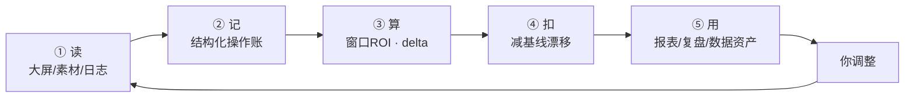

# 数据资产 · 完整闭环流程图

> 完整版（含每个数据点），按「5 个阶段」组织，每个阶段写清：**输入 → 处理 → 输出 → 存哪**。

---

## 快速版（先看这个）

```
① 读 → ② 记 → ③ 算 → ④ 扣 → ⑤ 用 →（再读）
```

- **读**：每 5 分钟读数据 + 你的操作
- **记**：把操作记成一条可统计的账
- **算**：10 分钟后，ROI 变了吗
- **扣**：扣掉账户本来就会的漂移
- **用**：下次同场景，直接看历史结论

---

# 完整版

## 阶段 1｜读数据（每 5 分钟）

**从哪读**：本机 Chrome → 千川（只读，不登录别人账户）

| 来源 | 读到什么数据 |
|---|---|
| **直播大屏** | `spend` 消耗 · `gmv` 成交 · `roi` ROI · `gpm` GPM · `cpm` CPM · `online_viewers` 在线 · `views` 观看 · `exposure_view_rate` 曝光观看率 · `view_conversion_rate` 观看成交转化率 · `live_room_id` 场次 · `live_started_at` 开播时间 · `plan_id` 计划 |
| **投放管理 · 素材 tab** | `basic_spend` 基础消耗 · `assist_spend` 追投消耗 · `materials[]`（`material_id` 素材ID · `name` 素材名 · `spend` 消耗 · `roi` ROI · `orders` 订单） |
| **投放管理 · 日志 tab** | 操作 `time` · `type`（新建/修改）· `任务ID` · `素材ID` · `调控预算` · `综合营销ROI目标`（=出价）· `优化目标` · `调控场景` |

**输出 / 存储**
- 盯盘快照 → `live_watch_logs.sqlite3`（表 `watch_reports`）
- 素材名册 → `.local/material_names.json`（`material_id → name`）

---

## 阶段 2｜记成账（结构化）

**把"一段日志文字"变成"一行可统计的记录"。**

| 处理 | 输入 | 输出 |
|---|---|---|
| **操作归类** `classify_operation()` | 日志原文 | `暂停追投 / 开追投 / 加追投预算 / 降追投预算 / 新建追投 / 加素材 / 删素材 / 一键起量 / 抢首屏 / 出价调整 / ROI目标调整 / 其他` |
| **身份回填** `_op_meta()` + 任务ID映射 | 任务ID、素材ID（新建日志） | `task_id` · `material_id` · `material_name`（查素材名册） |
| **参数抽取** `_op_meta()` | 日志 details | `budget` 预算 · `roi_target` ROI目标 · `optimization_goal` 优化目标 · `scenario` 调控场景 |
| **状态快照** `_state_of()` | 操作时刻的盯盘记录 | `velocity` 流速 · `online_viewers` 在线 · `cpm` · `exposure_view_rate` · `roi` · `assist_share` 追投占比 |

**输出**：一行操作账
```
时间 | 操作 | 素材名 | 素材ID | 任务名 | 预算 | ROI目标 | 流速 | 在线 | CPM | 追投占比
```

---

## 阶段 3｜算账（判断层）

| 步骤 | 公式 / 规则 | 用到的数据 |
|---|---|---|
| **1. 边际 ROI** | `窗口ROI = (GMV末 − GMV初) / (SPEND末 − SPEND初)` | `spend` · `gmv` |
| **2. 前后变化** | `pre = ROI(t−10→t)`，`post = ROI(t→t+10)`，`delta = post − pre` | 同上，取 ±10 分钟记录 |
| **3. 基线漂移** | `基线 = median(前后 7 分钟无操作的 delta)` | 全部有效记录 |
| **4. 净效应** | `净效应 = median(操作组 delta) − 基线` | 操作记录 + 基线 |
| **5. 排除重叠** | 只统计「此刻只有一种操作」的样本 | 操作时刻 |
| **6. 决策场景** | 按 `velocity` 三分位：偏低 / 正常 / 加快 | `velocity` |
| **7. 样本护栏** | `n ≥ 20` 才给结论 | 样本数 |
| **8. 判定** | `> +0.10` 正向 · `< −0.10` 负向 · 其余中性 | 净效应 |

> **保护规则**：消耗增量 ≤ 50 元 → 该窗口算不出，丢弃（避免除以极小值）。

---

## 阶段 4｜用起来（回流）

| 出口 | 内容 | 频率 | 存哪 |
|---|---|---|---|
| **盯盘报表** | 历史账本（各类操作净效应） | 每 5 分钟 | `watch_reports.report_markdown` |
| **直播复盘** | 历史账本（这场之后） | 每场结束 | `live_reviews.json` |
| **数据资产窗口** | 概览 / 决策场景 / 操作反馈 / 趋势 / 流水 | 实时 | API 读取 |
| **每日快照** | 当日资产状态 | 每天 08:10 | `asset_snapshots.json` |
| **操作流水** | 逐笔可追溯 | 实时 | API + CSV 导出 |

---

## 阶段 5｜回访（闭环）

| 时点 | 发生什么 |
|---|---|
| 你在千川**执行操作** | 平台日志 → 回到阶段 1 |
| **10 / 20 分钟后** | 新的盯盘记录 → 回填 `outcome`（delta、判定） |
| **下次同场景** | 数据资产里的结论更新 → 推荐更准 |

---

# 完整数据字典（一表看全）

| # | 数据点 | 来源 | 口径 | 用在哪 |
|---|---|---|---|---|
| 1 | `spend` | 直播大屏 | 场次累计消耗 | 窗口ROI分母、流速 |
| 2 | `gmv` | 直播大屏 | 场次累计成交 | 窗口ROI分子 |
| 3 | `roi` | 直播大屏 | 累计营销ROI | 目标对比、状态 |
| 4 | `gpm` | 直播大屏 | 千次观看成交 | 承接效率 |
| 5 | `cpm` | 直播大屏 | 千次曝光成本 | 流量成本、状态 |
| 6 | `online_viewers` | 直播大屏 | 实时在线 | 流速/承接、状态 |
| 7 | `views` | 直播大屏 | 累计观看 | GPM 分母 |
| 8 | `exposure_view_rate` | 直播大屏 | 曝光观看率 | 素材吸引力、状态 |
| 9 | `view_conversion_rate` | 直播大屏 | 观看成交转化率 | 承接能力 |
| 10 | `live_room_id` | 直播大屏 | 场次标识 | 分场 |
| 11 | `live_started_at` | 直播大屏 | 开播时间 | 复盘日期、场次 |
| 12 | `plan_id` | 直播大屏 | 计划 ID | 计划级关联 |
| 13 | `basic_spend` | 素材 tab | 基础计划消耗 | 结构 |
| 14 | `assist_spend` | 素材 tab | 追投/调控消耗 | 追投占比 |
| 15 | `materials[]` | 素材 tab | 素材级明细 | 素材级归因 |
| 16 | 操作 `time` | 日志 tab | 操作时间 | 时间锚点 |
| 17 | 操作 `type` | 日志 tab | 新建/修改 | 分类 |
| 18 | `任务ID` | 日志 tab | 追投任务 | 关联素材 |
| 19 | `素材ID` | 日志 tab | 素材标识 | 查素材名 |
| 20 | `调控预算` | 日志 tab | 新建值 或 A→B | 预算分析 |
| 21 | `综合营销ROI目标` | 日志 tab | 追投任务的ROI目标（=出价） | 出价/ROI分析 |
| 22 | `优化目标` | 日志 tab | 如 综合营销ROI | 场景分类 |
| 23 | `调控场景` | 日志 tab | 如 控成本追投 | 场景分类 |
| 24 | `material_names` | 素材读取 | 素材ID→名 | 可读、归因 |
| 25 | `velocity` | 计算 | Δspend / 分钟 | 场景分档 |
| 26 | `assist_share` | 计算 | assist/(basic+assist) | 结构 |
| 27 | `窗口ROI` | 计算 | ΔGMV/Δspend | 效果 |
| 28 | `delta` | 计算 | post − pre | 变化 |
| 29 | `基线` | 计算 | 无操作时刻中位 | 对照 |
| 30 | `净效应` | 计算 | 操作组 − 基线 | 结论 |

---

# 全流程图（Mermaid，GitHub 渲染）


