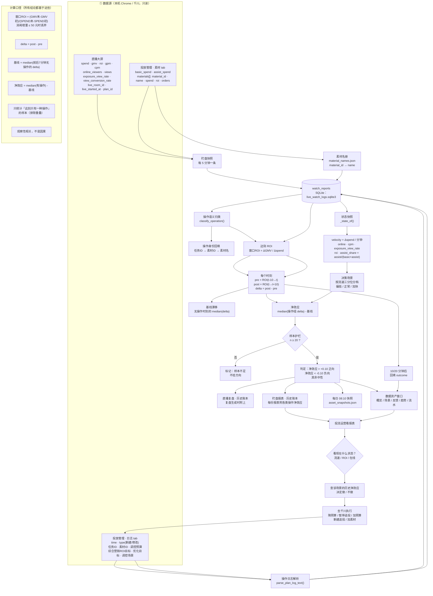

# 数据资产 · 闭环流程图（含每个数据点）

> 每个节点都标了**用到哪些数据、从哪来、怎么算**。源数据在本机，不出本机。

---

## 一、总览图（Mermaid，GitHub 可直接渲染）



---

## 二、逐节点数据字典

### ① 数据源（本机 Chrome，只读）

| 数据点 | 来源 | 口径 | 用在哪 |
|---|---|---|---|
| `spend` | 直播大屏 | **场次累计**消耗 | 窗口 ROI 分母、流速 |
| `gmv` | 直播大屏 | **场次累计**成交 | 窗口 ROI 分子 |
| `roi` | 直播大屏 | 场次累计 营销 ROI | 目标对比、状态 |
| `gpm` | 直播大屏 | 千次观看成交额 | 承接效率 |
| `cpm` | 直播大屏 | 千次曝光成本 | 流量成本、状态 |
| `online_viewers` | 直播大屏 | 实时在线人数 | 流速 / 承接 |
| `views` | 直播大屏 | 场次累计观看 | GPM 分母 |
| `exposure_view_rate` | 直播大屏 | 曝光观看率 % | 素材吸引力 |
| `view_conversion_rate` | 直播大屏 | 观看成交转化率 % | 承接能力 |
| `live_room_id` / `live_started_at` | 直播大屏 | 场次标识 / 开播时间 | 分场、复盘日期 |
| `plan_id` | 直播大屏 | 计划 ID | 计划级关联 |
| `basic_spend` / `assist_spend` | 素材 tab | 基础 / 追投调控消耗 | 结构、追投占比 |
| `materials[].material_id/name/spend/roi/orders` | 素材 tab | 素材级明细 | 素材级归因 |
| 操作 `time` / `type` | 日志 tab | 操作时间 / 新建或修改 | 时间锚点、分类 |
| 操作 `任务ID` / `素材ID` | 日志 tab | 追投任务 / 素材标识 | 关联素材 |
| 操作 `调控预算` | 日志 tab | 新建值 或 `A -> B` | 预算分析 |
| 操作 `综合营销ROI目标` | 日志 tab | 追投任务的 ROI 目标（=出价） | 出价/ROI 分析 |
| 操作 `优化目标` / `调控场景` | 日志 tab | 如 综合营销ROI / 控成本追投 | 场景分类 |

### ② 采集（每 5 分钟）

| 产物 | 存储 | 说明 |
|---|---|---|
| 盯盘快照 | `live_watch_logs.sqlite3` → `watch_reports` | 每条含上表全部字段 |
| 平台操作日志 | 同一条记录里的 `platform_operations[]` | 结构化：`{time,type,details,summary,day}` |
| 素材名册 | `.local/material_names.json` | `material_id → name` |

### ③ 结构化

| 步骤 | 函数 | 产出 |
|---|---|---|
| 操作归类 | `classify_operation()` | `暂停追投/加追投预算/降追投预算/新建追投/加素材/一键起量/…` |
| 身份回填 | `_op_meta()` + 任务ID映射 | `task_id / material_id / material_name` |
| 预算/ROI | `_op_meta()` | `budget / roi_target / optimization_goal / scenario` |
| 状态快照 | `_state_of()` | `velocity / online / cpm / exposure_view_rate / roi / assist_share` |

### ④ 判断

| 指标 | 公式 / 规则 | 备注 |
|---|---|---|
| 窗口 ROI | `(GMV末 - GMV初) / (SPEND末 - SPEND初)` | 消耗增量 ≤ 50 元 → 丢弃 |
| delta | `post_roi - pre_roi` | pre = t-10→t，post = t→t+10 |
| 基线 | `median(无操作时刻的 delta)` | **不扣它会全错**（实测 -0.10/10分钟） |
| 净效应 | `median(操作组 delta) - 基线` | 才是"相对什么都不做"的好坏 |
| 操作重叠 | 只统计"此刻只有一种操作" | 否则所有类型继承同一效应 |
| 决策场景 | 按流速三分位（偏低/正常/加快） | 聚合会掩盖规律 |
| 判定 | n≥20 且 >+0.10 正向 / <-0.10 负向 / 其余中性 | n<20 = 样本不足 |

### ⑤ 应用 / 回流

| 出口 | 内容 | 频率 |
|---|---|---|
| 盯盘报表 | 历史账本（各类操作净效应） | 每 5 分钟 |
| 直播复盘 | 历史账本 | 每场结束 |
| 数据资产窗口 | 概览 / 决策场景 / 操作反馈 / 趋势 / 流水 | 实时 |
| 每日快照 | `asset_snapshots.json` | 每天 08:10 |

### ⑥ 运营动作（返回 ①）

| 动作 | 回到哪 |
|---|---|
| 降预算 / 暂停追投 / 加预算 / 新建追投 / 加素材 | 千川 → 日志 tab → ① |

### ⑦ 回写（闭环）

| 时点 | 动作 |
|---|---|
| 操作后 10 / 20 分钟 | 新盯盘记录 → 回填 outcome |
| 下次同场景 | 数据资产依据更新 → 推荐更准 |

---

## 三、闭环的一句话

```
看状态 → 查该场景的历史 → 决定做不做 → 执行 → 10/20 分钟后回访 → 写回 → 下次更准
```

**关键**：**状态（when）× 操作（what）× 结果（outcome）** 三件套，缺一个就闭不上环。
